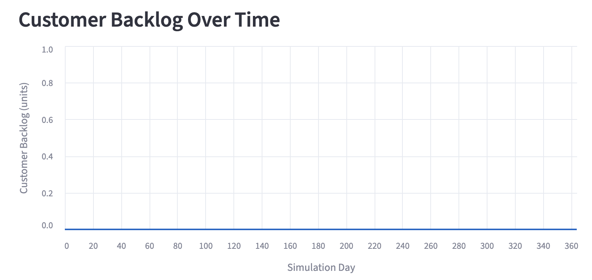
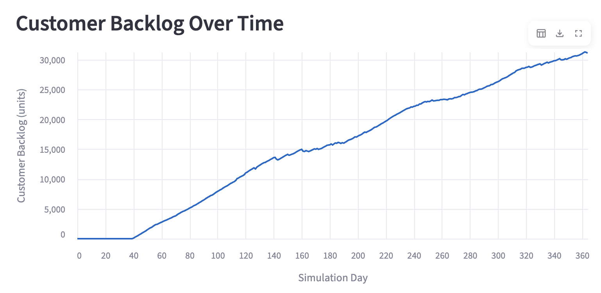

# ChainPilot

## Supply Chain Planning Assistant

ChainPilot is a small Python tool for supply-chain planning.

Live demo: [Open ChainPilot](https://chainpilot.streamlit.app/)

It checks:

- Inventory
- Customer backlog
- Supplier lead time
- Transport cost
- Supply risk

The project also includes a simple AI assistant.
The assistant can answer data questions and policy questions.

## Main features

- Python supply-chain simulation
- Multi-agent decision logic
- Baseline scenario
- Geopolitical disruption scenario
- Pandas data analysis
- Lead-time analysis
- Customer backlog monitoring
- Transport-cost analysis
- Streamlit web app
- LangChain RAG
- Optional local Ollama LLM
- English and Traditional Chinese questions

## How the assistant works

```text
User asks a question
        |
        v
The app checks the question type
        |
        +-- Data question
        |       |
        |       +-- Python reads CSV data
        |
        +-- Known policy question
        |       |
        |       +-- The app uses the related policy file
        |
        +-- Other question
                |
                +-- LangChain RAG uses policy files and Ollama
```

## Data sources

- `daily_records.csv`: inventory and customer backlog
- `shipments.csv`: delivery time and transport cost
- `documents/`: supply-chain policy files
- The app shows the source of each answer.

## Project files

```text
multi-agent/
├── requirements.txt
├── README.md
├── documents/
│   ├── inventory_policy.txt
│   ├── procurement_policy.txt
│   ├── safety_stock_policy.txt
│   └── supplier_lead_time_policy.txt
├── simulator/
│   ├── app.py
│   ├── analytics.py
│   ├── data_queries.py
│   ├── langchain_rag.py
│   ├── prediction.py
│   └── ...
└── data/
    ├── demo_baseline_365/
    │   ├── daily_records.csv
    │   └── shipments.csv
    └── demo_geopolitical/
        ├── daily_records.csv
        └── shipments.csv
```

## Install the project

Open Terminal in the project folder.

Install the Python packages:

```bash
python3 -m pip install -r requirements.txt
```

For optional local AI features, install the Ollama models:

```bash
ollama pull llama3.2:3b
ollama pull nomic-embed-text
```

Ollama is not required for the online demo.
The full local RAG pipeline uses Ollama for document search and answer generation.

Run this command only if Ollama is not already running locally:

```bash
ollama serve
```

## Start the web app

Run this command:

```bash
python3 -m streamlit run simulator/app.py
```

Open the local URL shown in Terminal.

## How to use Ask ChainPilot

1. Select a scenario:
   - `baseline`
   - `geopolitical`
2. Enter a question in the `Ask ChainPilot` box.
3. Click `Ask AI`.
4. Read the answer and the source files.

The selected scenario changes simulation data and risk results.
For example, inventory, backlog, service rate, and transport cost can change between scenarios.

### Example questions

Data questions:

- What is the latest US distribution center inventory?
- What is the average lead time for each route?
- Which route has the highest transport cost?

Policy questions:

- How should we respond to a longer delivery time?
- What should we do when stock covers less than 7 days?
- When should we use fast transport?
- How should we set safety stock?

The online demo supports data questions and common policy questions.
The full LangChain RAG pipeline is available when the app runs locally with Ollama.

## Run the simulation

```bash
python3 -m simulator.main \
  --scenario baseline \
  --days 365 \
  --decision_mode rule_based_bdi \
  --out_dir data/demo_baseline_365
```

## Run tests

```bash
python3 -m unittest simulator.test -v
```

## Scenario comparison

### Baseline

The supply chain works under normal conditions.
Customer demand is fully served.
There is no final customer backlog.



### Geopolitical disruption

Supply capacity and transport capacity are lower.
Customer demand is higher.
The system has a large customer backlog.
Service rate falls and total cost increases.



Use the Scenario selector in the app to compare both cases.

### What changes in the app

When you select `baseline`:

- The customer backlog chart stays at zero.
- The app shows no supply risk alerts.
- Customer demand is fully served.

When you select `geopolitical`:

- The customer backlog chart increases over time.
- The app shows supply risk alerts.
- The service rate falls.
- Total cost increases.
